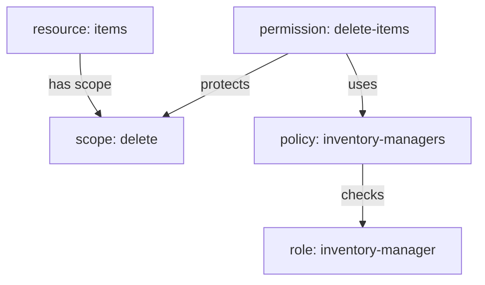

# Resources, Scopes And Permissions

A resource server that knows nothing about the API cannot protect it. Before Keycloak can decide anything, you have to describe what the inventory API holds and what can be done to it. This part builds that description one object at a time, joins it to rules, and then asks Keycloak for its first decisions.

## The four objects and how they connect

Authorization Services uses four kinds of object, and each has one job. A **scope** is an action, such as `view`. A **resource** is a thing to protect, such as `items`, and it lists the scopes that apply to it. A **policy** is a rule that grants or denies on its own, such as "the user has the role `inventory-manager`". A **permission** joins them: it names the resources or scopes it protects and the policies that must grant.



The diagram shows one chain: the permission `delete-items` protects the scope `delete` of the resource `items`, and it grants only when the policy `inventory-managers` grants.

There are two kinds of permission. A **resource-based permission** protects whole resources, with all their scopes. A **scope-based permission** protects chosen scopes, optionally on chosen resources. The inventory API needs a different rule per action, so it uses scope-based permissions.

## Create the scopes and the resource

All the commands below need the same helpers. `authz_id` looks up the id of a scope, resource or policy by its name, because one Keycloak object always refers to another by its id. The Admin REST API names the id field of a resource `_id`, and of a scope or policy `id`.

<!-- astrona:playground:renew -->

```sh
NAMESPACE=model-demo
kcadm() {
  kubectl -n "$NAMESPACE" exec -i deploy/keycloak -- \
    /opt/keycloak/bin/kcadm.sh "$@" --config /tmp/kcadm.config
}
kcadm config credentials --server http://localhost:8080 --realm master --user admin --password admin
API_ID=$(kcadm get clients -r inventory -q clientId=inventory-api --fields id --format csv --noquotes)
AUTHZ="clients/$API_ID/authz/resource-server"
authz_id() {
  local field=id
  [ "$1" = resource ] && field=_id
  kcadm get "$AUTHZ/$1/search" -r inventory -q name="$2" --fields "$field" --format csv --noquotes
}
```

These commands expect authorization to be switched on for `inventory-api`. If you have not done it in this playground yet, run `kcadm update clients/$API_ID -r inventory -s authorizationServicesEnabled=true` first.

Create the three scopes. Each one is only a name; it gets meaning from the resource that lists it and the permission that protects it:

```sh
for scope in view edit delete; do kcadm create $AUTHZ/scope -r inventory -s name=$scope; done
```

Now create the resource `items`. Its `uris` are the API paths it stands for, its `type` groups resources of the same kind, and its `scopes` list the three actions by name:

```sh
kcadm create $AUTHZ/resource -r inventory -s name=items \
  -s type=urn:inventory-api:resources:item -s 'uris=["/items","/items/*"]' \
  -s "scopes=[{\"name\":\"view\"},{\"name\":\"edit\"},{\"name\":\"delete\"}]"
kcadm get $AUTHZ/resource/$(authz_id resource items)/scopes -r inventory --fields name
```

The second command lists the scopes of `items`: `view`, `edit` and `delete`. The resource server now knows what it protects, but nothing protects it yet.

## Write the role policies

A role policy grants when the user has a given role. It refers to the role by its id, so look the role up first. Create one policy for viewers and one for managers:

```sh
VIEWER_ROLE_ID=$(kcadm get roles/inventory-viewer -r inventory --fields id --format csv --noquotes)
MANAGER_ROLE_ID=$(kcadm get roles/inventory-manager -r inventory --fields id --format csv --noquotes)
kcadm create $AUTHZ/policy/role -r inventory -s name=inventory-viewers -s logic=POSITIVE \
  -s "roles=[{\"id\":\"$VIEWER_ROLE_ID\",\"required\":false}]"
kcadm create $AUTHZ/policy/role -r inventory -s name=inventory-managers -s logic=POSITIVE \
  -s "roles=[{\"id\":\"$MANAGER_ROLE_ID\",\"required\":false}]"
```

`logic=POSITIVE` keeps the policy's result as it is; `NEGATIVE` would turn a grant into a deny. `required` matters only when a policy lists several roles: a required role must be present, while the others are alternatives.

## Join them with scope permissions

Each permission names the resource, one scope and the policies that must grant. Create the three permissions the inventory rules need:

```sh
kcadm create $AUTHZ/permission/scope -r inventory -s name=view-items -s decisionStrategy=UNANIMOUS \
  -s "resources=[\"$(authz_id resource items)\"]" -s "scopes=[\"$(authz_id scope view)\"]" \
  -s "policies=[\"$(authz_id policy inventory-viewers)\"]"
kcadm create $AUTHZ/permission/scope -r inventory -s name=edit-items -s decisionStrategy=UNANIMOUS \
  -s "resources=[\"$(authz_id resource items)\"]" -s "scopes=[\"$(authz_id scope edit)\"]" \
  -s "policies=[\"$(authz_id policy inventory-managers)\"]"
kcadm create $AUTHZ/permission/scope -r inventory -s name=delete-items -s decisionStrategy=UNANIMOUS \
  -s "resources=[\"$(authz_id resource items)\"]" -s "scopes=[\"$(authz_id scope delete)\"]" \
  -s "policies=[\"$(authz_id policy inventory-managers)\"]"
```

Keycloak stores a permission as a special kind of policy, so `authz_id policy delete-items` also finds a permission by name.

## Ask Keycloak for a decision

The API asks Keycloak with the `uma-ticket` grant at the token endpoint. The request carries the user's access token, the resource server as `audience`, the wanted `permission` as `resource#scope`, and `response_mode=decision`. Keycloak answers `200` with `{"result": true}` when it grants, and `403` with the error `access_denied` when it denies.

Define a helper that sends that request from the `tester` pod and prints only the status code. It gets the user's token with the password grant, which is only for terminal use:

```sh
user_token() {
  kubectl -n "$NAMESPACE" exec deploy/tester -- sh -c \
    "curl -s http://keycloak:8080/realms/inventory/protocol/openid-connect/token \
      -d grant_type=password -d client_id=inventory-cli \
      -d username=$1 -d password=$1-password | jq -r .access_token"
}
decision() {
  kubectl -n "$NAMESPACE" exec deploy/tester -- curl -s -o /dev/null -w '%{http_code}\n' \
    http://keycloak:8080/realms/inventory/protocol/openid-connect/token \
    -H "Authorization: Bearer $(user_token "$1")" \
    -d grant_type=urn:ietf:params:oauth:grant-type:uma-ticket \
    -d audience=inventory-api -d permission="$2" -d response_mode=decision
}
for user in alice bob; do for scope in view edit delete; do echo "$user $scope $(decision $user items#$scope)"; done; done
```

`alice` gets `200` for all three scopes, because she holds both roles. `bob` gets `200` for `view` and `403` for `edit` and `delete`. Keycloak made each decision from the permission for that scope; no code in any API checked a role.

You can now describe an API as a resource with scopes, write role policies, and protect each scope with a permission. The model so far has exactly one policy per permission. The open question is what Keycloak does when a permission uses several policies that disagree, or when a request matches no permission at all.

## Common pitfalls

> [!WARNING]
> - **Creating a policy and expecting it to protect something.** A policy only decides. Without a permission that uses it, it changes no decision.
> - **Passing names where Keycloak expects ids.** A role policy, a resource's scope list and a permission refer to other objects by id. Look ids up with `authz_id` and `kcadm get roles/<name>`.
> - **Forgetting `audience` in a decision request.** A `permission` parameter needs `audience` set to the resource server's client ID.
> - **Reading `403` as an error in the request.** For a decision request, `403` with `access_denied` is a valid answer: denied.

## Your mission: Model The Inventory API As A Resource Server

You can now turn a client into a resource server and protect each of its actions with a permission. The graded lab gives you a fresh Keycloak with authorization switched off and asks you to build the whole model so that `alice` may view, edit and delete, and `bob` may only view.

The lab runs in its own cluster, so first pause your playground. Nothing in it is lost:

```sh
astrona stop ats-091-playground-010-01
```

Then start the lab:

```sh
astrona run --git ssh://git@github.com/astrona-io/ATS091.git -c sections/section-010/module-01/labs/lab-01
```

The task is on the next page. Solve it on your own first. When you think you are done, send it for grading:

```sh
astrona submit -c sections/section-010/module-01/labs/lab-01
```

When the lab is done, remove it and start your playground again:

```sh
astrona destroy ats-091-lab-010-01
astrona start ats-091-playground-010-01
```
