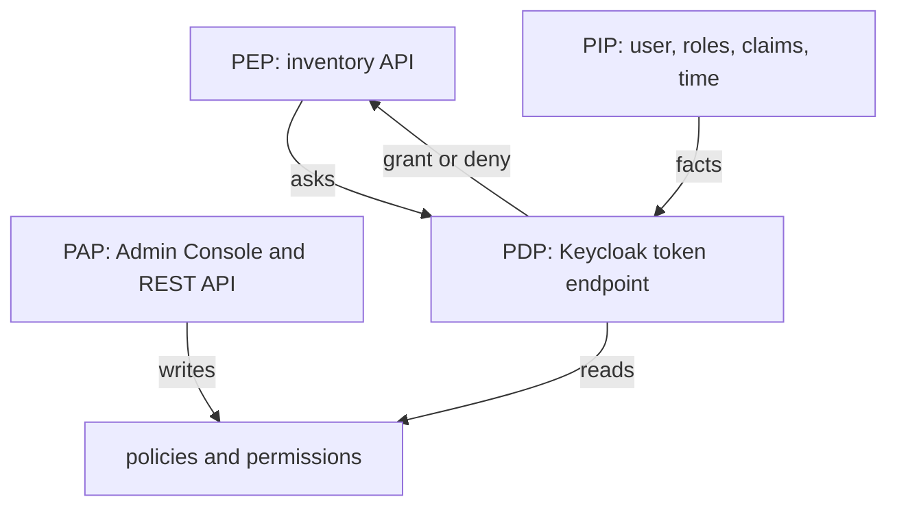

# The Four Components Of The Architecture

A request for `DELETE /items/7` involves more than one program. The API receives the request, Keycloak decides, and somebody must have written the rules and told both sides what exists. The authorization model names these jobs, and the names appear in the Keycloak documentation, in logs and in exam questions. This part defines the four components, shows which Keycloak part plays each one, and runs one decision so you see them work together.

## The four components

The first component is the **policy enforcement point**, short **PEP**. It is the code that stands in front of a protected resource, receives the request and enforces the answer. For the inventory API, the PEP is the API itself, or a filter or library inside it. The PEP never decides. It asks, and it allows or refuses what it is told.

The second component is the **policy decision point**, short **PDP**. It evaluates the policies and returns grant or deny. In Keycloak, the PDP is the authorization service inside the server. You reach it at the token endpoint of the realm with the `uma-ticket` grant, and also through the evaluation endpoint of the Admin REST API.

The third component is the **policy administration point**, short **PAP**. It is where a person or a script creates and changes resources, scopes, policies and permissions. In Keycloak, the PAP is the Admin Console and the Admin REST API. The Protection API, which a resource server uses to register its own resources, is a second way into the same store.

The fourth component is the **policy information point**, short **PIP**. It supplies the facts a policy needs while it evaluates: who the user is, which roles and groups the user has, what the token claims say, which client asks, what time it is and which attributes the resource has. In Keycloak, those facts come from the realm's own data and from the request.



The diagram shows that the PEP only talks to the PDP, and that the PAP and the PIP never talk to the PEP.

## Watch the components work

Define the helpers once. `kcadm.sh` is Keycloak's administration command-line tool, and it calls the Admin REST API, so every `kcadm` command below is the PAP at work.

<!-- astrona:playground:renew -->

```sh
NAMESPACE=settings-demo
kcadm() {
  kubectl -n "$NAMESPACE" exec -i deploy/keycloak -- \
    /opt/keycloak/bin/kcadm.sh "$@" --config /tmp/kcadm.config
}
kcadm config credentials --server http://localhost:8080 --realm master --user admin --password admin
API_ID=$(kcadm get clients -r inventory -q clientId=inventory-api --fields id --format csv --noquotes)
AUTHZ="clients/$API_ID/authz/resource-server"
user_token() {
  kubectl -n "$NAMESPACE" exec deploy/tester -- sh -c \
    "curl -s http://keycloak:8080/realms/inventory/protocol/openid-connect/token \
      -d grant_type=password -d client_id=inventory-cli \
      -d username=$1 -d password=$1-password | jq -r .access_token"
}
decision() {
  kubectl -n "$NAMESPACE" exec deploy/tester -- curl -s -o /dev/null -w '%{http_code}\n' \
    http://keycloak:8080/realms/inventory/protocol/openid-connect/token \
    -H "Authorization: Bearer $(user_token "$1")" \
    -d grant_type=urn:ietf:params:oauth:grant-type:uma-ticket \
    -d audience="${3:-inventory-api}" -d permission="$2" -d response_mode=decision
}
```

The token request in `user_token` uses the password grant. It is only for terminal testing; a real application never sends a user's password to the token endpoint.

List what the PAP stored. The permissions are the objects the PDP reads first:

```sh
kcadm get $AUTHZ/permission -r inventory --fields name,type,decisionStrategy
```

Now act as a PEP. The `decision` helper sends the request an API would send, and the answer is the PDP's:

```sh
for user in alice bob; do echo "$user delete $(decision $user items#delete)"; done
```

`alice` gets `200` and `bob` gets `403`. The PDP found the permission `delete-items`, evaluated its policy `inventory-managers`, and read the PIP facts it needed, here the roles of each user. Nothing in a script of yours decided the result.

## Where the PIP gets its facts

A policy only sees what the PDP can find. A role policy reads the roles of the user from the realm. A group policy reads the user's groups. A client policy reads the client that sends the request. A time policy reads the clock of the Keycloak server. A JavaScript policy can read the claims of the token and the attributes of the resource through the evaluation context.

This is why a decision can change without any change to a policy. If you add a role to `bob`, the same policy gives a different result for him, because the PIP facts changed. Add the role `inventory-manager` to `bob`, ask again, and remove it so the playground stays as it was:

```sh
kcadm add-roles -r inventory --uusername bob --rolename inventory-manager
echo "bob delete $(decision bob items#delete)"
kcadm remove-roles -r inventory --uusername bob --rolename inventory-manager
echo "bob delete $(decision bob items#delete)"
```

The first answer is `200` and the second is `403`. `bob` needs a new token for each request, and the helper fetches one each time, so the PDP sees his current roles.

You can now name the four components and point at the Keycloak part that plays each one. The PAP stores the model and the PDP evaluates it, but the PDP also has settings of its own: how it treats a request that matches nothing, and how it combines results. The next part reads and changes those settings.

## Common pitfalls

> [!WARNING]
> - **Treating the API as the decision maker.** The API is the PEP. It enforces the answer of the PDP; it does not own the rules.
> - **Mixing up the PAP and the PDP.** Creating a policy with `kcadm.sh` changes the store. Only a decision request or an evaluation request makes the PDP evaluate it.
> - **Expecting a decision to stay the same when the facts change.** Roles, groups and the clock are inputs. A change in any of them changes the result without any change to a policy.
