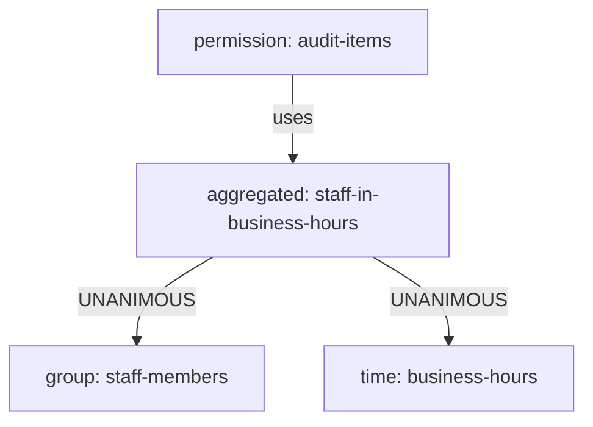

# Time Policies And Aggregated Policies

Some rules depend on when a request arrives, not only on who sends it. "Deletes only during business hours" is a common one, because a mistake during the day is noticed and fixed at once. Other rules need two conditions at once: "members of staff, and only during business hours". This part creates a time policy, shows why its result depends on the server's clock, and then combines it with a group policy in an aggregated policy.

## A time policy

A time policy grants when the current time is inside the window its fields describe. The fields are a start time and an expire time (`notBefore` and `notOnOrAfter`, in the format `yyyy-MM-dd HH:mm:ss`), and ranges for the day of the month, the month, the year, the hour and the minute (`dayMonth`/`dayMonthEnd`, `month`/`monthEnd`, `year`/`yearEnd`, `hour`/`hourEnd`, `minute`/`minuteEnd`). Every field you set must hold at the same time. Keycloak reads the time from the server's own clock, and in the Keycloak container that clock runs in Coordinated Universal Time (UTC).

The commands below use the same helpers as everywhere in this module, and the permission `audit-items` on the scope `audit` of `items`. `use_policy` swaps the policy of `audit-items` and prints both users' decisions. The token request inside `decision` uses the password grant, which is only for terminal testing.

<!-- astrona:playground:renew -->

```sh
NAMESPACE=policies-demo
kcadm() {
  kubectl -n "$NAMESPACE" exec -i deploy/keycloak -- \
    /opt/keycloak/bin/kcadm.sh "$@" --config /tmp/kcadm.config
}
kcadm config credentials --server http://localhost:8080 --realm master --user admin --password admin
API_ID=$(kcadm get clients -r inventory -q clientId=inventory-api --fields id --format csv --noquotes)
AUTHZ="clients/$API_ID/authz/resource-server"
authz_id() {
  local field=id
  [ "$1" = resource ] && field=_id
  kcadm get "$AUTHZ/$1/search" -r inventory -q name="$2" --fields "$field" --format csv --noquotes
}
user_token() {
  kubectl -n "$NAMESPACE" exec deploy/tester -- sh -c \
    "curl -s http://keycloak:8080/realms/inventory/protocol/openid-connect/token \
      -d grant_type=password -d client_id=inventory-cli \
      -d username=$1 -d password=$1-password | jq -r .access_token"
}
decision() {
  kubectl -n "$NAMESPACE" exec deploy/tester -- curl -s -o /dev/null -w '%{http_code}\n' \
    http://keycloak:8080/realms/inventory/protocol/openid-connect/token \
    -H "Authorization: Bearer $(user_token "$1")" \
    -d grant_type=urn:ietf:params:oauth:grant-type:uma-ticket \
    -d audience=inventory-api -d permission="$2" -d response_mode=decision
}
use_policy() {
  kcadm update $AUTHZ/permission/scope/$(authz_id policy audit-items) -r inventory \
    -s "policies=[\"$(authz_id policy "$1")\"]"
  echo "alice $(decision alice items#audit) bob $(decision bob items#audit)"
}
```

If the scope `audit`, the permission `audit-items` or the group policy `staff-members` does not exist in your playground yet, create them first. The `audit` scope must also be listed on `items`:

```sh
kcadm create $AUTHZ/scope -r inventory -s name=audit
kcadm update $AUTHZ/resource/$(authz_id resource items) -r inventory \
  -s "scopes=[{\"name\":\"view\"},{\"name\":\"edit\"},{\"name\":\"delete\"},{\"name\":\"audit\"}]"
kcadm create $AUTHZ/permission/scope -r inventory -s name=audit-items \
  -s "resources=[\"$(authz_id resource items)\"]" -s "scopes=[\"$(authz_id scope audit)\"]" \
  -s "policies=[\"$(authz_id policy inventory-viewers)\"]"
kcadm create $AUTHZ/policy/group -r inventory -s name=staff-members -s "groups=[{\"id\":\"$(kcadm get groups -r inventory -q search=staff -q exact=true --fields id --format csv --noquotes | head -n 1)\",\"extendChildren\":false}]"
```

Each command fails with a "conflict" message when the object already exists, and you can ignore that. Now create the time policy `business-hours` for the hours 8 to 17, check the hour the cluster has right now, and use the policy:

```sh
kcadm create $AUTHZ/policy/time -r inventory -s name=business-hours -s hour=8 -s hourEnd=17
kubectl -n "$NAMESPACE" exec deploy/tester -- date -u +%H
use_policy business-hours
```

When the hour is between 8 and 17, both users get `200`; outside that window, both get `403`. Your result depends on when you read this page. That is the nature of a time policy, and it is the reason a test of a time policy must say what time it is.

To see a time policy that always denies, give one an expire time in the past:

```sh
kcadm create $AUTHZ/policy/time -r inventory -s name=expired-window -s 'notOnOrAfter=2000-01-01 00:00:00'
use_policy expired-window
```

Both users get `403`, at any hour. An expire time is useful for access that should end on a fixed date, such as a contractor's last day.

## An aggregated policy

An aggregated policy combines other policies with a decision strategy, exactly like a permission does, but it is itself a policy. You can reuse it in several permissions, and you can put it inside another aggregated policy. Combine `staff-members` and `business-hours`, with `UNANIMOUS`, so both must grant:

```sh
kcadm create $AUTHZ/policy/aggregate -r inventory -s name=staff-in-business-hours -s decisionStrategy=UNANIMOUS \
  -s "policies=[\"$(authz_id policy staff-members)\",\"$(authz_id policy business-hours)\"]"
use_policy staff-in-business-hours
```

`bob` gets `403` at any hour, because he is not in `staff`, and `UNANIMOUS` needs both policies. `alice` gets `200` during business hours and `403` outside them. Notice what that means for testing: `bob`'s answer does not depend on the clock, while `alice`'s does.



The diagram shows the permission using one aggregated policy, which grants only when the group policy and the time policy both grant.

You can now write rules that depend on the clock and rules that need several conditions at once. The time policy reads the server's clock in UTC, and the aggregated policy combines results with a decision strategy of its own. The question still open is how to express a rule that no built-in policy type covers.

## Common pitfalls

> [!WARNING]
> - **Forgetting that the server clock is UTC.** "8 to 17" means UTC hours, not your local time. Convert the business hours before you set the fields.
> - **Setting several time fields and expecting either one to apply.** All fields of a time policy must hold together.
> - **Choosing `AFFIRMATIVE` for an aggregated policy that means "and".** One granting policy is then enough, so `bob` would get through during business hours.
> - **Testing a time policy without checking the time.** Always look at the hour first, or test with a user whose answer does not depend on it.

## Your mission: Allow Deletes Only For Staff In Business Hours

You can now combine a group policy and a time policy into one rule. The graded lab gives you the role-based inventory model and asks you to narrow the delete permission so that only members of `staff` may delete, and only during business hours.

The lab runs in its own cluster, so first pause your playground. Nothing in it is lost:

```sh
astrona stop ats-091-playground-020-01
```

Then start the lab:

```sh
astrona run --git ssh://git@github.com/astrona-io/ATS091.git -c sections/section-020/module-01/labs/lab-01
```

The task is on the next page. Solve it on your own first. When you think you are done, send it for grading:

```sh
astrona submit -c sections/section-020/module-01/labs/lab-01
```

When the lab is done, remove it and start your playground again:

```sh
astrona destroy ats-091-lab-020-01
astrona start ats-091-playground-020-01
```
