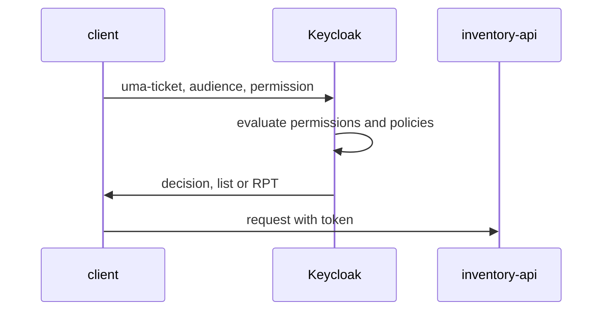

# Asking Keycloak For A Decision

Every policy and permission exists for one moment: when an API asks Keycloak whether a request may go through. The API does that with one request to the token endpoint, the `uma-ticket` grant. The same grant can return three kinds of answer: a yes or no, a list of what the user may do, or a token that carries the permissions. This part sends all three and reads each one.

## The uma-ticket grant

The request is a `POST` to the realm's token endpoint, `/realms/inventory/protocol/openid-connect/token`, with `grant_type=urn:ietf:params:oauth:grant-type:uma-ticket`. The user's access token goes in the `Authorization: Bearer` header. The most useful parameters are:

| Parameter | What it does |
| --- | --- |
| `audience` | The client ID of the resource server, here `inventory-api`. Required with `permission` |
| `permission` | What to evaluate, as `RESOURCE#SCOPE`, for example `items#delete`. Repeat it for several. `items` alone means every scope of `items` |
| `response_mode` | `decision` for a yes or no, `permissions` for a list; left out, the answer is a token |
| `response_include_resource_name` | `true` adds the resource names to the permissions |
| `response_permissions_limit` | The highest number of permissions to return |

When Keycloak denies, every mode answers the same way: HTTP `403` with `"error": "access_denied"`.

<!-- astrona:playground:renew -->

The helpers below get a token for a user and send a `uma-ticket` request with any extra parameters you pass. The token request uses the password grant, which is only for terminal testing; a real application uses the authorization code flow.

```sh
NAMESPACE=policies-demo
user_token() {
  kubectl -n "$NAMESPACE" exec deploy/tester -- sh -c \
    "curl -s http://keycloak:8080/realms/inventory/protocol/openid-connect/token \
      -d grant_type=password -d client_id=inventory-cli \
      -d username=$1 -d password=$1-password | jq -r .access_token"
}
ask_keycloak() {
  local user="$1"; shift
  kubectl -n "$NAMESPACE" exec deploy/tester -- curl -s \
    http://keycloak:8080/realms/inventory/protocol/openid-connect/token \
    -H "Authorization: Bearer $(user_token "$user")" \
    -d grant_type=urn:ietf:params:oauth:grant-type:uma-ticket -d audience=inventory-api "$@"
}
```

## A decision

Ask for one decision for each user, and print the whole body this time:

```sh
ask_keycloak alice -d permission=items#delete -d response_mode=decision; echo
ask_keycloak bob -d permission=items#delete -d response_mode=decision; echo
```

For `alice`, the body is `{"result":true}`. For `bob`, it is a JSON error with `access_denied`, and the status code, which this command does not print, is `403`. A decision is the cheapest answer, and the one a policy enforcement point in an API uses on every request.

## A list of permissions

With `response_mode=permissions`, Keycloak evaluates everything you ask for and lists what it grants. Leave out `permission`, and it evaluates every resource of the resource server:

```sh
ask_keycloak bob -d response_mode=permissions -d response_include_resource_name=true | jq
```

The answer is a list with one entry per granted resource. Each entry has `rsid` (the resource id), `rsname` (the name, because you asked for it) and `scopes`. For `bob`, the scopes of `items` hold `view` and nothing he is denied. A user interface can use this list to show only the buttons a user may press.

## A requesting party token

Without `response_mode`, Keycloak answers like any token request: a JSON object with an `access_token`. That access token is a requesting party token (RPT). It is a normal signed access token with one extra claim, `authorization`, which lists the granted permissions. Ask for one and decode its payload:

```sh
ask_keycloak alice -d permission=items | jq -r .access_token \
  | cut -d. -f2 | tr '_-' '/+' | base64 -d 2>/dev/null | jq '.authorization'
```

The `authorization` claim holds `permissions`, a list with `items` and the scopes `alice` may use on it. An API can accept an RPT and read the permissions from it without asking Keycloak again, until the token expires. That saves requests, but a change to a policy only takes effect when the API sees a new RPT. The base64 tool may warn about padding; the JSON still prints.



The diagram shows the three kinds of answer coming from the same grant; which one the caller gets depends only on `response_mode`.

You can now ask Keycloak for a decision, a list of permissions or an RPT, and read each answer. The decision is the simplest for an API to use, the list is the most useful for a user interface, and the RPT moves the decision into a token that lives for a while. The question still open is how an API turns these answers into `200` and `403` for its own requests.

## Common pitfalls

> [!WARNING]
> - **Sending `permission` without `audience`.** Keycloak cannot know which resource server's resources you mean.
> - **Treating `403` as a failure of the request.** For this grant, `403` with `access_denied` is the answer "denied".
> - **Caching an RPT for a long time.** Its permissions are fixed when it is issued. A changed policy only applies to new RPTs.
> - **Reading the list of permissions as complete when it was limited.** `response_permissions_limit` cuts the list; leave it out when you need everything.
