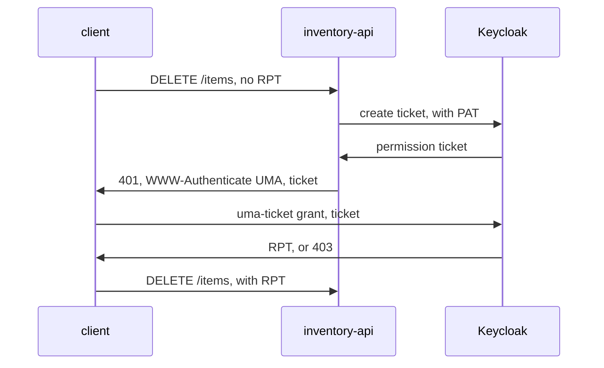

# UMA 2.0, Permission Tickets And The RPT

An API that refuses a request usually just says `403`. The client then has no idea what it would need to get in. UMA 2.0 answers that: the API refuses with a permission ticket that names exactly what the request needs, and the client takes that ticket to Keycloak. This part walks through the whole flow by hand, so that each step is a request you can see.

## The UMA flow

The flow has three actors besides Keycloak: the client (an application acting for a user), the resource server (the API) and the user. A resource server talks to Keycloak through the Protection API, using a protection API token (PAT), an access token with the scope `uma_protection`. Keycloak gives every resource server's service account the role `uma_protection`, so the resource server gets a PAT with the client credentials grant.



The diagram shows the API answering the first request with `401` and a `WWW-Authenticate: UMA` header that holds `realm`, `as_uri` (Keycloak's address) and `ticket`; the client exchanges the ticket for an RPT and sends the request again.

The `inventory-api` in your playground does not answer with tickets; it asks Keycloak for a decision directly. So this part plays the API's role by hand with `curl`, one step at a time.

## Get a protection API token

The helpers below send requests from the `tester` pod. `user_token` uses the password grant, which is only for terminal testing; a real client uses the authorization code flow. `pat` uses the client credentials grant of `inventory-api`, with its lab-only client secret.

<!-- astrona:playground:renew -->

```sh
NAMESPACE=uma-demo
KEYCLOAK=http://keycloak:8080/realms/inventory
in_tester() { kubectl -n "$NAMESPACE" exec deploy/tester -- "$@"; }
user_token() {
  in_tester sh -c "curl -s $KEYCLOAK/protocol/openid-connect/token \
    -d grant_type=password -d client_id=inventory-cli \
    -d username=$1 -d password=$1-password | jq -r .access_token"
}
pat() {
  in_tester sh -c "curl -s $KEYCLOAK/protocol/openid-connect/token \
    -d grant_type=client_credentials -d client_id=inventory-api \
    -d client_secret=inventory-api-secret | jq -r .access_token"
}
PAT=$(pat)
echo "$PAT" | cut -d. -f2 | tr '_-' '/+' | base64 -d 2>/dev/null | jq '{azp, scope}'
```

The decoded payload shows `azp` (authorized party, the client that got the token) as `inventory-api`, and `scope` contains `uma_protection`. That scope is what lets the token call the Protection API. The base64 tool may warn about missing padding; the JSON still prints.

## Find the resource and create a ticket

The Protection API has its own view of the resources, under `/authz/protection/resource_set`. Look up the id of `items` there, then ask Keycloak for a ticket for the scope `delete` of that resource:

```sh
ITEMS_ID=$(in_tester curl -s -H "Authorization: Bearer $PAT" "$KEYCLOAK/authz/protection/resource_set?name=items" | jq -r '.[0]')
TICKET=$(in_tester curl -s -X POST "$KEYCLOAK/authz/protection/permission" \
  -H "Authorization: Bearer $PAT" -H 'Content-Type: application/json' \
  -d "[{\"resource_id\":\"$ITEMS_ID\",\"resource_scopes\":[\"delete\"]}]" | jq -r .ticket)
echo "${TICKET:0:40}..."
```

The ticket is a long opaque value; the command prints its start. It names the resource and the scope a request needs, and only Keycloak can read it. This is what the API would put into the `WWW-Authenticate: UMA` header of its `401`.

## Exchange the ticket for an RPT

Now play the client. It sends the ticket with the `uma-ticket` grant, with the user's access token as the bearer token. Try it as `alice` and as `bob`:

```sh
for user in alice bob; do
  echo "$user: $(in_tester curl -s -o /dev/null -w '%{http_code}' $KEYCLOAK/protocol/openid-connect/token \
    -H "Authorization: Bearer $(user_token $user)" \
    -d grant_type=urn:ietf:params:oauth:grant-type:uma-ticket -d ticket=$TICKET)"
done
```

`alice` gets `200`, and `bob` gets `403`. Keycloak evaluated the permission `delete-items` for the resource and scope in the ticket. Ask again as `alice` and decode the RPT she receives:

```sh
in_tester curl -s $KEYCLOAK/protocol/openid-connect/token \
  -H "Authorization: Bearer $(user_token alice)" \
  -d grant_type=urn:ietf:params:oauth:grant-type:uma-ticket -d ticket=$TICKET \
  | jq -r .access_token | cut -d. -f2 | tr '_-' '/+' | base64 -d 2>/dev/null | jq '.authorization'
```

The `authorization` claim holds `permissions`, a list with the resource id of `items` and the scope `delete`. The client sends this RPT to the API, and the API can check the claim without asking Keycloak again. Asking with a ticket is the UMA way to say "give me exactly what this request needs", while asking with `permission=items#delete` and an `audience` says the same without a ticket.

You now know the whole UMA flow: the PAT that lets a resource server use the Protection API, the ticket that names what a request needs, and the RPT that carries the granted permissions. In this flow, the resource server owns every resource. The open question is what changes when a user owns a resource and decides who else may use it.

## Common pitfalls

> [!WARNING]
> - **Calling the Protection API with a user's token.** It needs a PAT: a token of the resource server itself, with the scope `uma_protection`.
> - **Treating the ticket as a permission.** A ticket only names what is needed. The RPT, issued after Keycloak evaluates the policies, is what grants.
> - **Reusing a ticket for a different request.** A ticket belongs to the resources and scopes it was created for; create a new one for a different request.
> - **Forgetting that the RPT is fixed when issued.** A permission removed later still appears in an RPT issued earlier, until it expires.
