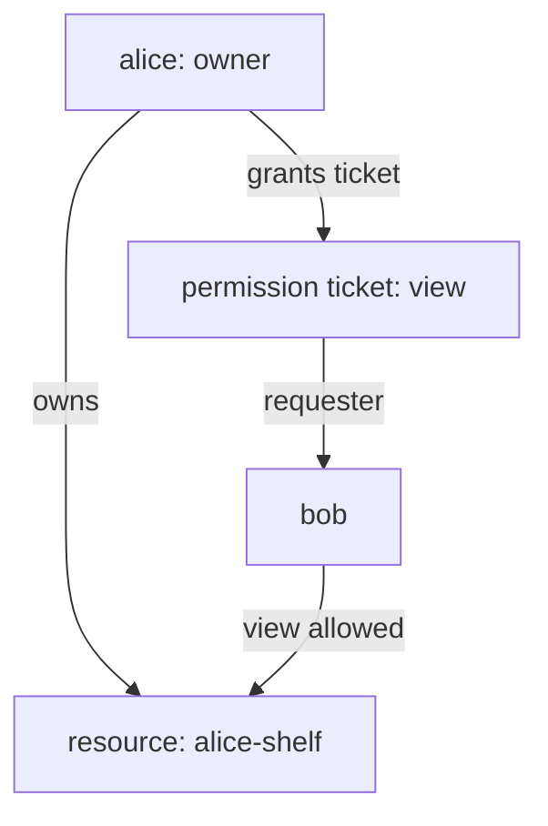

# User-Managed Access And Sharing

So far every resource belonged to the resource server, and administrators wrote every rule. Many applications also have resources that belong to one user: a shelf of items, a document, a photo album. The owner, not an administrator, should decide who else may see it. UMA 2.0 calls this User-Managed Access, and Keycloak implements it with resources that have an owner and permission tickets that the owner grants. This part creates a resource owned by `alice` and lets her share it with `bob`.

## Switch on User-Managed Access

User-Managed Access is a realm setting. In the Admin Console it is **User-managed access** on the **General** tab of **Realm settings**; in the Admin REST API it is `userManagedAccessAllowed`. It lets users see and manage their resources in the Account Console, under **My Resources**.

The helpers below run `kcadm.sh` in the Keycloak pod and send requests from the `tester` pod. `user_token` uses the password grant, which is only for terminal testing. `pat` gets a protection API token for `inventory-api` with its lab-only client secret.

<!-- astrona:playground:renew -->

```sh
NAMESPACE=uma-demo
KEYCLOAK=http://keycloak:8080/realms/inventory
kcadm() {
  kubectl -n "$NAMESPACE" exec -i deploy/keycloak -- \
    /opt/keycloak/bin/kcadm.sh "$@" --config /tmp/kcadm.config
}
kcadm config credentials --server http://localhost:8080 --realm master --user admin --password admin
in_tester() { kubectl -n "$NAMESPACE" exec deploy/tester -- "$@"; }
user_token() {
  in_tester sh -c "curl -s $KEYCLOAK/protocol/openid-connect/token \
    -d grant_type=password -d client_id=inventory-cli \
    -d username=$1 -d password=$1-password | jq -r .access_token"
}
pat() {
  in_tester sh -c "curl -s $KEYCLOAK/protocol/openid-connect/token \
    -d grant_type=client_credentials -d client_id=inventory-api \
    -d client_secret=inventory-api-secret | jq -r .access_token"
}
decision() {
  in_tester curl -s -o /dev/null -w '%{http_code}\n' $KEYCLOAK/protocol/openid-connect/token \
    -H "Authorization: Bearer $(user_token "$1")" \
    -d grant_type=urn:ietf:params:oauth:grant-type:uma-ticket \
    -d audience=inventory-api -d permission="$2" -d response_mode=decision
}
kcadm update realms/inventory -s userManagedAccessAllowed=true
```

## A resource owned by a user

The resource server creates user-owned resources through the Protection API, with a PAT. The resource names its `owner` (a user id) and sets `ownerManagedAccess` to `true`, which lets the owner manage access to it. Create the resource `alice-shelf` with the scope `view`, owned by `alice`:

```sh
ALICE_ID=$(kcadm get users -r inventory -q username=alice -q exact=true --fields id --format csv --noquotes)
PAT=$(pat)
in_tester curl -s -X POST "$KEYCLOAK/authz/protection/resource_set" \
  -H "Authorization: Bearer $PAT" -H 'Content-Type: application/json' \
  -d "{\"name\":\"alice-shelf\",\"owner\":\"$ALICE_ID\",\"ownerManagedAccess\":true,\"resource_scopes\":[\"view\"]}" | jq '{_id, name, owner}'
for user in alice bob; do echo "$user $(decision $user alice-shelf#view)"; done
```

The response shows the new resource's `_id`, its name and its owner. `alice` gets `200`, because the owner of a resource has access to it. `bob` gets `403`: no permission covers `alice-shelf`, the resource server is in `ENFORCING` mode, and `alice` has not shared it.

## Share it

The owner shares a resource by granting a permission ticket to another user. In the Account Console, `alice` would open **My Resources**, pick `alice-shelf`, choose **Share**, enter `bob` and the scope `view`. The Account Console is at `/realms/inventory/account`; with `kubectl -n uma-demo port-forward svc/keycloak 8080:8080` running, open `http://localhost:8080/realms/inventory/account` and sign in as `alice`.

The resource server can do the same through the Protection API, which is what the Account Console asks Keycloak to do. A granted ticket names the resource, the requesting user and the scope:

```sh
BOB_ID=$(kcadm get users -r inventory -q username=bob -q exact=true --fields id --format csv --noquotes)
SHELF_ID=$(in_tester curl -s -H "Authorization: Bearer $PAT" "$KEYCLOAK/authz/protection/resource_set?name=alice-shelf" | jq -r '.[0]')
in_tester curl -s -X POST "$KEYCLOAK/authz/protection/permission/ticket" \
  -H "Authorization: Bearer $PAT" -H 'Content-Type: application/json' \
  -d "{\"resource\":\"$SHELF_ID\",\"requester\":\"$BOB_ID\",\"granted\":true,\"scopeName\":\"view\"}" | jq '{id, granted}'
echo "bob $(decision bob alice-shelf#view)"
```

The ticket comes back with `granted` set to `true`, and `bob` now gets `200` for `alice-shelf#view`. No administrator wrote a policy: the grant came from the owner. A user can also request access: with `submit_request=true` and a ticket, Keycloak records the request, and the owner approves or denies it under **My Resources**.



The diagram shows ownership and sharing: `alice` owns the resource and grants a ticket, and the granted ticket lets `bob` use the scope `view`.

You now know how a realm allows User-Managed Access, how a resource gets an owner, and how the owner shares it. Owner-managed access sits next to the administrator's policies; it does not replace them. The question left is the code that sits in the API and turns all these decisions into `200` and `403`.

## Common pitfalls

> [!WARNING]
> - **Forgetting `ownerManagedAccess`.** Without it, a resource with an owner does not appear for sharing under **My Resources**.
> - **Creating user-owned resources with a user's token.** The Protection API needs the resource server's PAT; the owner is a field of the resource.
> - **Expecting a shared resource to change the administrator's permissions.** A granted ticket covers only the resource and scope it names.
> - **Leaving User-Managed Access off.** Without `userManagedAccessAllowed`, users cannot manage their resources in the Account Console.
