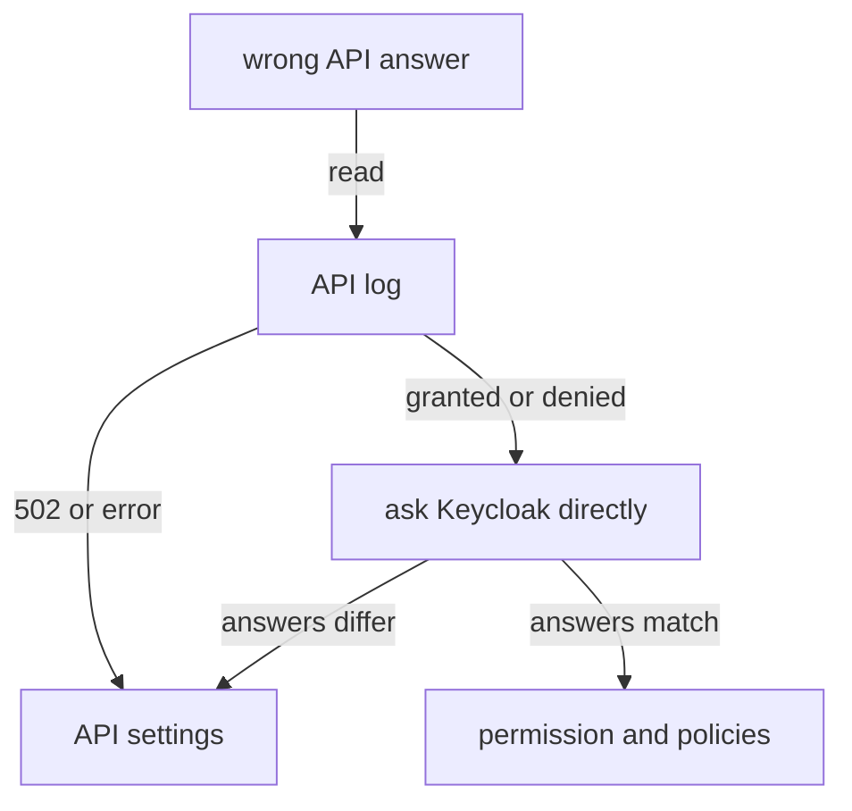

# A Policy Enforcement Point In An API

Everything so far was about Keycloak's side: the model, the policies and the decisions. An API still has to ask, and it has to ask the right question. A policy enforcement point (PEP) is the code in an API that maps a request to a resource and a scope, asks Keycloak, and lets the request through or refuses it. This part reads a small one, sends it requests as each user, and traces its answers back to Keycloak.

## What inventory-api does

`inventory-api` is a short Node.js HTTP server, loaded from the ConfigMap `inventory-api-code`. Keycloak also ships policy enforcers for some languages and frameworks; this one is written by hand so every step is visible. Print the part that talks to Keycloak:

<!-- astrona:playground:renew -->

```sh
NAMESPACE=uma-demo
kubectl -n "$NAMESPACE" get configmap inventory-api-code -o jsonpath='{.data.server\.js}' | sed -n '/SCOPE_FOR_METHOD =/p;/async function askKeycloak/,/^}$/p'
```

The code shows three decisions the API makes before Keycloak sees anything. `SCOPE_FOR_METHOD` maps `GET` to `view`, `POST` to `edit` and `DELETE` to `delete`. The `permission` it sends is `items#<scope>`, where `items` comes from the setting `PROTECTED_RESOURCE`. The `audience` comes from `KEYCLOAK_AUDIENCE`. It sends the user's own bearer token with the `uma-ticket` grant and `response_mode=decision`, and turns `403` into `403` for the caller. Read the settings:

```sh
kubectl -n "$NAMESPACE" get deployment inventory-api -o jsonpath='{range .spec.template.spec.containers[0].env[*]}{.name}={.value}{"\n"}{end}'
```

The four settings are `KEYCLOAK_URL`, `KEYCLOAK_REALM`, `KEYCLOAK_AUDIENCE` and `PROTECTED_RESOURCE`. If any of them is wrong, the API asks Keycloak the wrong question, and a correct model gives a wrong answer.

## Send it requests

The helper below sends a request to `inventory-api` from the `tester` pod as a user and prints the status code. The token request uses the password grant, which is only for terminal testing. Send every method as each user, and once without a token:

```sh
user_token() {
  kubectl -n "$NAMESPACE" exec deploy/tester -- sh -c \
    "curl -s http://keycloak:8080/realms/inventory/protocol/openid-connect/token \
      -d grant_type=password -d client_id=inventory-cli \
      -d username=$1 -d password=$1-password | jq -r .access_token"
}
call_api() {
  kubectl -n "$NAMESPACE" exec deploy/tester -- curl -s -o /dev/null -w '%{http_code}\n' \
    -X "$2" -H "Authorization: Bearer $(user_token "$1")" http://inventory-api:3000/items
}
for user in alice bob; do for method in GET POST DELETE; do echo "$user $method $(call_api $user $method)"; done; done
kubectl -n "$NAMESPACE" exec deploy/tester -- curl -s -o /dev/null -w '%{http_code}\n' http://inventory-api:3000/items
```

`alice` gets `200` for all three methods. `bob` gets `200` for `GET` and `403` for `POST` and `DELETE`. The request without a token gets `401`, which the API decides on its own, without asking Keycloak.

## Trace an answer back to Keycloak

When an answer looks wrong, follow it in three steps. First, the API's log shows what it asked and what Keycloak answered:

```sh
kubectl -n "$NAMESPACE" logs deploy/inventory-api --tail=6
```

Each line names the method, the path, the scope and the decision (`granted`, `denied`) or an error. A `502` from the API with an error line means Keycloak did not return a decision at all. A wrong setting, such as an `audience` that names the wrong client, can also show up only as `denied` for every user, so do not stop at the log.

Second, ask Keycloak the same question directly, with the same user, `audience` and `permission`. If Keycloak's answer matches the API's, the API is fine and the model is the place to look. If they differ, the API asked a different question than you think, and its settings are the place to look.

Third, in the model, find the permission for that scope and read its policies and decision strategy. The Admin Console's **Evaluate** tab on the client `inventory-api` does the same in a browser: pick a user and a resource, and it shows which permissions granted and which denied.



The diagram shows the order of the investigation: the API's log first, then a direct question to Keycloak, and only then either the API's settings or the model.

You can now read a policy enforcement point, predict its answers from the model, and trace a wrong answer to the side that caused it. The API and Keycloak share one contract: the resource name, the scopes and the audience must match on both sides.

## Common pitfalls

> [!WARNING]
> - **Fixing the API's code when the model is wrong.** If Keycloak gives the same wrong answer when asked directly, the fault is in the permissions or policies.
> - **A resource or scope name that differs between the API and Keycloak.** The API asks for `items#delete`; a resource named differently, or one that does not list `delete`, never grants it.
> - **Switching the resource server to `PERMISSIVE` to make a `403` go away.** It also grants everything that no permission covers.
> - **Forgetting that `401` and `403` mean different things.** `401` means no valid token; `403` means Keycloak denied the request.

## Your mission: Make The API Refuse Deletes For Viewers

You can now trace a wrong answer from `inventory-api` to its cause and fix it on the right side. The graded lab gives you an API that lets `bob`, a viewer, delete items, and asks you to make it refuse him while `alice` keeps every right, without touching the API.

The lab runs in its own cluster, so first pause your playground. Nothing in it is lost:

```sh
astrona stop ats-091-playground-030-01
```

Then start the lab:

```sh
astrona run --git ssh://git@github.com/astrona-io/ATS091.git -c sections/section-030/module-01/labs/lab-01
```

The task is on the next page. Solve it on your own first. When you think you are done, send it for grading:

```sh
astrona submit -c sections/section-030/module-01/labs/lab-01
```

When the lab is done, remove it and start your playground again:

```sh
astrona destroy ats-091-lab-030-01
astrona start ats-091-playground-030-01
```
